# Microsoft Entra ID Enterprise SSO — SAML 2.0 & OpenID Connect


## Project Overview


This project demonstrates the implementation, troubleshooting, and validation of enterprise Single Sign-On (SSO) using **Microsoft Entra ID** with two commonly used authentication and federation protocols:


- **SAML 2.0** — Microsoft Entra ID integrated with Salesforce

- **OpenID Connect (OIDC)** — Microsoft Entra ID integrated with a custom Python/Flask Employee Portal using the Authorization Code flow


The project simulates an enterprise IAM environment containing both a traditional SaaS application using SAML federation and a modern web application using OpenID Connect.


Beyond configuring authentication, the project implements:


- Group-based application access

- Enterprise Application assignment enforcement

- Positive and negative authorization testing

- SAML identity mapping

- OIDC Authorization Code flow

- Authentication troubleshooting

- Microsoft Entra sign-in log investigation

- Independent post-configuration validation using Microsoft Graph PowerShell


---


## Business Scenario


An organization is centralizing application authentication through Microsoft Entra ID.


The environment contains applications using different authentication protocols:


- **Salesforce** requires enterprise federation using SAML 2.0.

- A custom **Contoso Employee Portal** uses OpenID Connect.

- Application access must be controlled through Microsoft Entra ID security groups.

- Unauthorized users must be prevented from accessing protected applications.

- Authentication failures must be investigated using application errors, protocol evidence, and Microsoft Entra sign-in logs.


The objective is to provide centralized authentication while maintaining application-specific authorization controls.


---


## Architecture


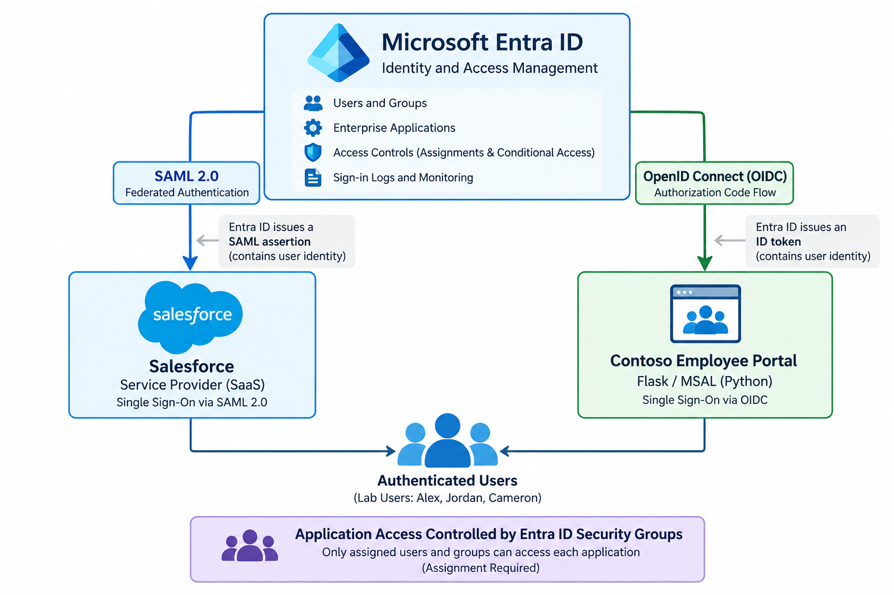


### SAML Authentication Path

```text
User
  ↓
Salesforce
  ↓
Microsoft Entra ID
  ↓
SAML Authentication
  ↓
SAML Assertion
  ↓
Salesforce
  ↓
Authenticated Session
```


### OpenID Connect Authentication Path

```text
User
  ↓
Contoso Employee Portal
  ↓
Microsoft Entra ID
  ↓
OIDC Authorization Request
  ↓
Authorization Code
  ↓
Contoso Employee Portal
  ↓
ID Token
  ↓
Authenticated Session
```


---


## Technologies Used


| Technology | Purpose |

|---|---|

| Microsoft Entra ID | Identity provider and centralized application access control |

| Enterprise Applications | Service principal and application assignment management |

| App Registrations | OIDC application identity and authentication configuration |

| SAML 2.0 | Federated authentication with Salesforce |

| OpenID Connect | Authentication for the Employee Portal |

| OAuth 2.0 Authorization Code Flow | Authorization flow supporting OIDC authentication |

| Salesforce Developer Edition | SAML Service Provider |

| Python | Employee Portal application |

| Flask | Web application framework |

| Microsoft Authentication Library (MSAL) | Microsoft identity platform integration |

| Microsoft Graph PowerShell | Independent configuration validation |

| Entra Sign-in Logs | Authentication and authorization investigation |


---


# Identity & Access Design


Application access was designed around **security-group-based assignment** rather than individual user assignments.


Two application-specific security groups were used:


```text

SG-APP-Salesforce-Users

SG-APP-EmployeePortal-Users

```


Three test identities supported positive and negative testing:


| User | Salesforce | Employee Portal | Purpose |

|---|---:|---:|---|

| Alex Carter | Authorized | Authorized | Positive authentication testing |

| Jordan Lee | Authorized | Authorized | Secondary positive authorization testing |

| Cameron Brooks | Unauthorized | Unauthorized | Negative authorization testing |


Alex Carter and Jordan Lee were members of the appropriate application access groups.


Cameron Brooks was intentionally excluded.


For both Enterprise Applications:


```text

Assignment required = Yes

```


This demonstrates an important IAM distinction:


> **Authentication establishes identity. Authorization determines whether that identity may access the application.**


---


# SAML 2.0 — Salesforce


## Integration Design


For the SAML implementation:


```text

Microsoft Entra ID = Identity Provider (IdP)

Salesforce          = Service Provider (SP)

```


Microsoft Entra ID authenticates the user and issues a signed SAML assertion that Salesforce consumes to establish the application session.


The integration included:


- Salesforce Enterprise Application

- SAML-based Single Sign-On

- Entity Identifier

- Reply URL / Assertion Consumer Service endpoint

- Microsoft Entra federation metadata

- Identity Provider certificate

- SAML issuer

- NameID claim

- Salesforce Federation ID

- Group-based application assignment

- Assignment-required enforcement


The Salesforce Federation ID was mapped to the Microsoft Entra user identity supplied through the SAML NameID.


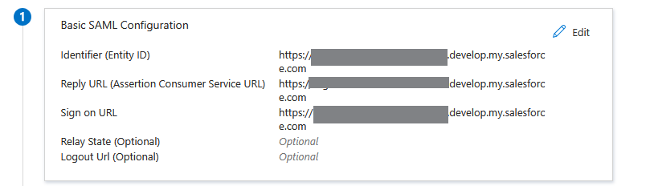


---


## Group-Based Salesforce Access


The security group:


```text

SG-APP-Salesforce-Users

```


was assigned to the Salesforce Enterprise Application.


The Enterprise Application was configured with:


```text

Assignment required = Yes

```


This ensured that only explicitly assigned users or members of an assigned group could access Salesforce through the Entra integration.


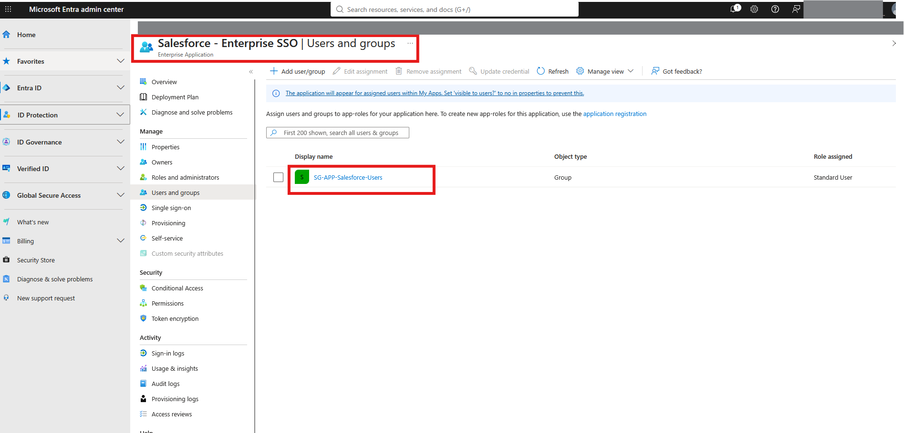


---


## Successful SAML Authentication


An SP-initiated authentication test was performed through Salesforce.


Salesforce redirected the user to Microsoft Entra ID for authentication. After successful authentication, Microsoft Entra ID returned the SAML response to Salesforce.


Alex Carter successfully accessed Salesforce through federated SSO.


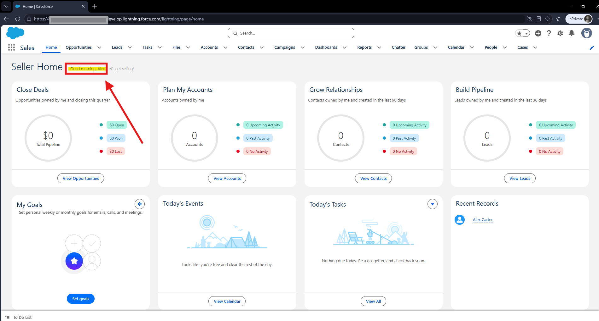


---


# OpenID Connect — Contoso Employee Portal


## Integration Design


The second implementation demonstrates authentication for a modern server-side web application.


```text

Microsoft Entra ID      = OpenID Provider

Contoso Employee Portal = OIDC Client / Relying Party

Authentication Flow     = Authorization Code

Application Framework   = Flask

Identity Library        = MSAL

```


Unlike the Salesforce integration, the Employee Portal uses an **App Registration** to represent the application's identity and authentication configuration in Microsoft Entra ID.


---


## Authorization Code Flow


The application redirects the browser to the Microsoft identity platform authorization endpoint.


The authentication request uses the Authorization Code flow:


```text

response\_type=code

```


After authentication, Microsoft Entra ID returns an authorization code to the registered Redirect URI:


```text

http://localhost:5000/auth/callback

```


The server-side application then completes the authorization-code flow and obtains identity information for the authenticated user.


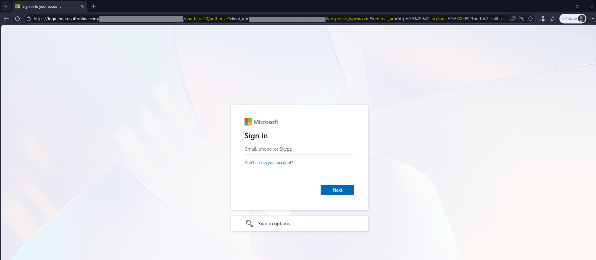


---


## Successful OIDC Authentication


The Employee Portal uses identity information returned through the OIDC authentication process to establish the user's application session.


The portal displays selected identity and authentication context while sensitive identifiers are redacted from public project evidence.


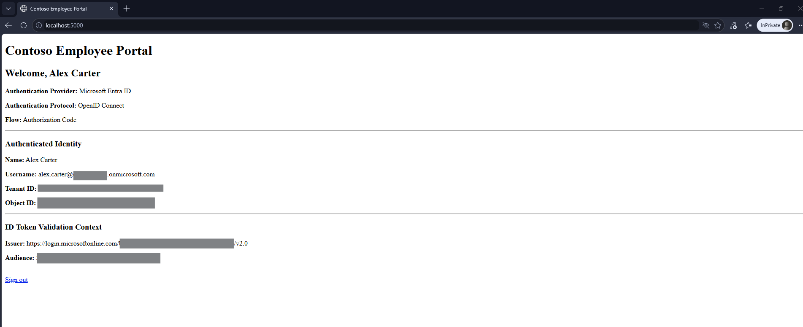


---


# Application Authorization


Authentication alone does not provide access to either application.


Microsoft Entra Enterprise Application assignments provide an additional authorization layer.


For the Employee Portal:


```text

SG-APP-EmployeePortal-Users

```


was assigned to the Enterprise Application and:


```text

Assignment required = Yes

```


was enabled.


---


## Authorized User — Jordan Lee


Jordan Lee was a member of:


```text

SG-APP-EmployeePortal-Users

```


After authenticating through Microsoft Entra ID, Jordan successfully accessed the Employee Portal.


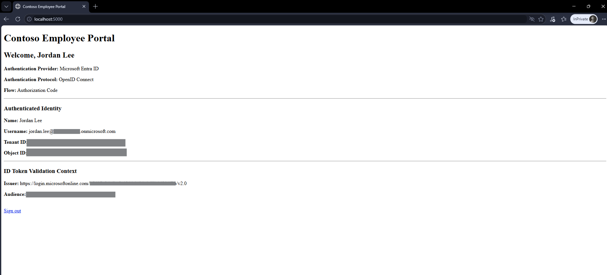


---


## Unauthorized User — Cameron Brooks


Cameron Brooks was intentionally excluded from the Employee Portal access group.


When Cameron attempted to access the application, Microsoft Entra ID blocked access with:


```text

AADSTS50105

```


The error indicated that the user was not directly assigned and was not a member of a group assigned to the application.


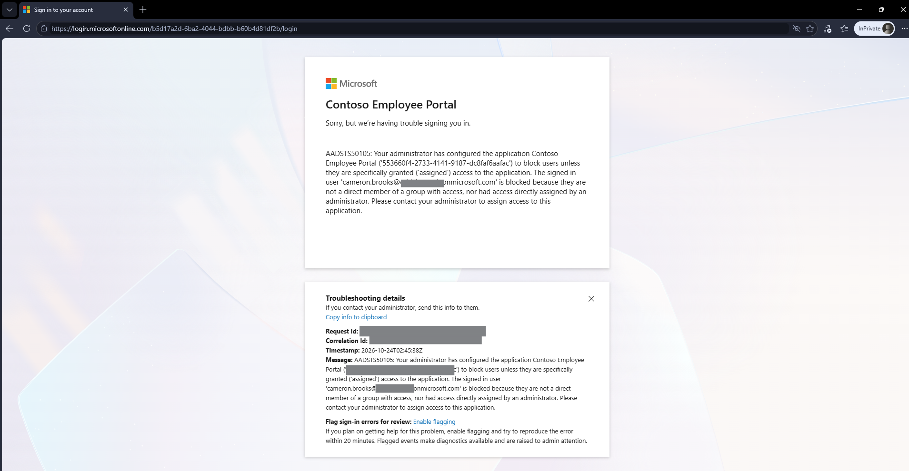


This validates the distinction between **authentication** and **application authorization**.


A user can possess a valid Entra identity while still being denied access to a specific Enterprise Application.


---


# Troubleshooting


Troubleshooting was treated as a core component of the project rather than simply documenting successful configurations.


Each major troubleshooting scenario followed:


```text
Failure
  ↓
Evidence
  ↓
Investigation
  ↓
Root Cause
  ↓
Remediation
  ↓
Verification
```


---


## SAML Troubleshooting — Federation ID / NameID Mapping


A controlled identity-mapping failure was introduced by changing Alex Carter's Salesforce Federation ID so that it no longer matched the identity supplied by Microsoft Entra ID.


### Failure


The SAML authentication attempt reached Salesforce, but Salesforce could not map the incoming SAML subject to the appropriate Salesforce user.


### Evidence & Investigation


Salesforce SAML validation showed that major protocol-level checks succeeded while user mapping failed.


The validator reported that Salesforce was unable to map the subject to a Salesforce user.


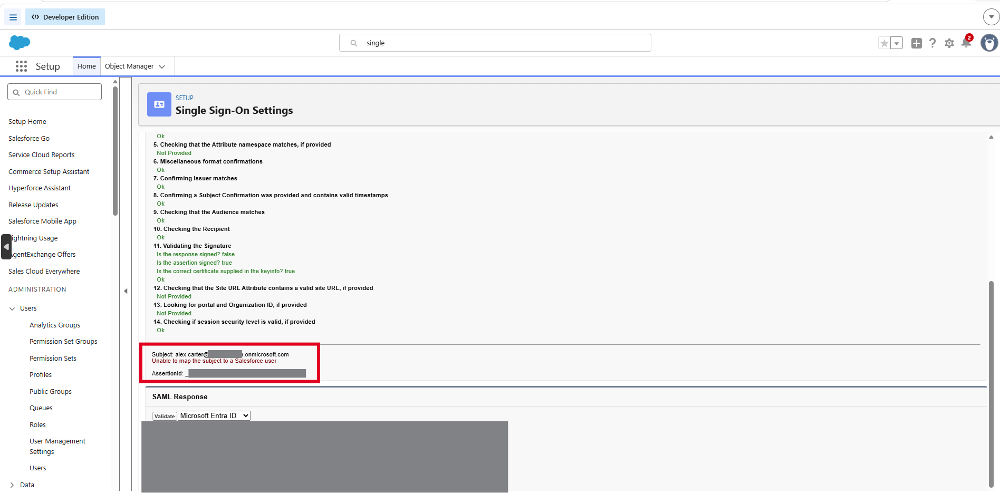


### Root Cause


The Federation ID configured on the Salesforce user did not match the NameID value supplied in the SAML assertion.


### Remediation


The Salesforce Federation ID was restored to the correct identity value.


### Verification


SAML SSO was tested again and completed successfully.


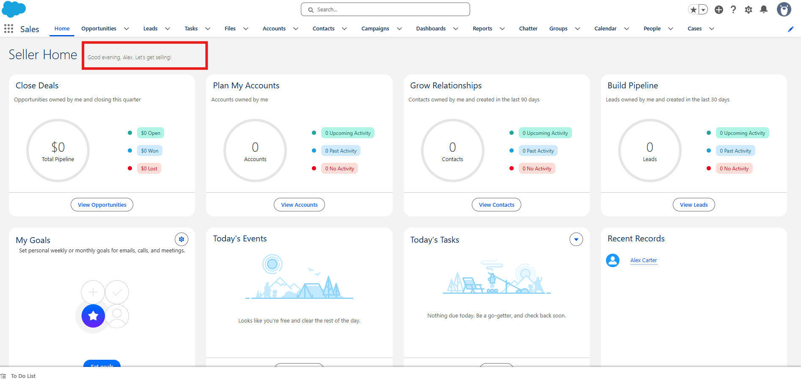


### Key Finding


This scenario demonstrated that the SAML trust relationship and assertion validation can succeed while authentication still fails at the Service Provider because of incorrect identity mapping.


---


# OIDC Troubleshooting


## MSAL Reserved Scope Error


During initial Employee Portal development, the application encountered an MSAL reserved-scope error.


```text

ValueError: You cannot use any scope value that is reserved.

```


### Investigation


The authentication implementation was reviewed to determine how OIDC scopes were being supplied to MSAL.


### Root Cause


The initial authentication logic manually supplied reserved OIDC scope values in a way that conflicted with MSAL's handling of those scopes.


### Remediation


The authentication logic was changed to use MSAL's authorization-code-flow helpers:


```python

initiate\_auth\_code\_flow()

```


and:


```python

acquire\_token\_by\_auth\_code\_flow()

```


### Verification


The application successfully generated the Microsoft Entra authorization request and completed authentication after the implementation was corrected.


---


## Redirect URI Mismatch — AADSTS50011


A controlled Redirect URI misconfiguration was introduced after establishing a known-good OIDC configuration.


The application temporarily used:


```text

http://localhost:5000/auth/callback-bad

```


while Microsoft Entra ID had:


```text

http://localhost:5000/auth/callback

```


registered for the application.


Microsoft Entra ID rejected the request with:


```text

AADSTS50011

```


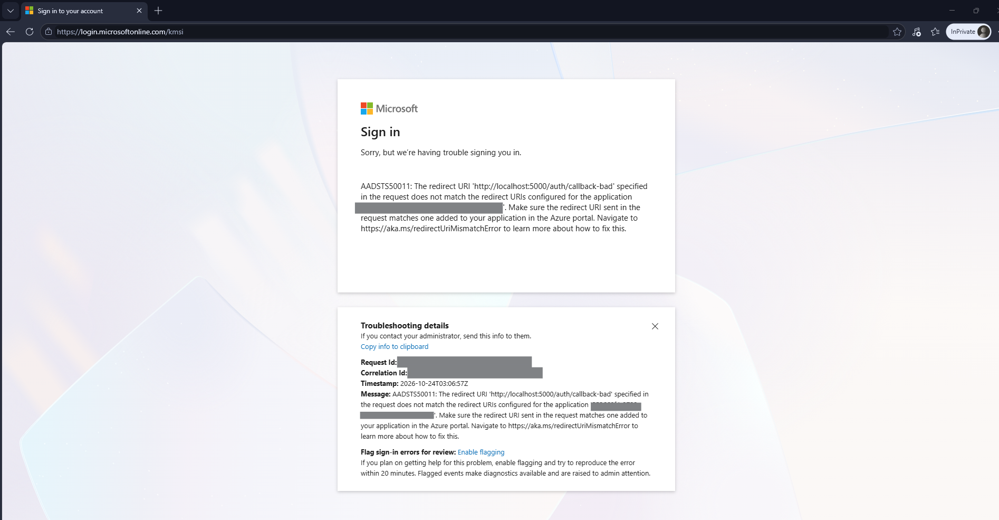


### Root Cause


The Redirect URI supplied by the application did not exactly match a Redirect URI registered for the App Registration.


### Remediation


The application configuration was restored to:


```text

http://localhost:5000/auth/callback

```


### Verification


Authentication was repeated successfully.


This demonstrates the importance of exact Redirect URI matching in OAuth 2.0 and OpenID Connect flows.


---


# Microsoft Graph Validation


Microsoft Graph PowerShell was used as an **independent post-configuration validation layer**.


The purpose was not to rebuild the integrations through PowerShell. Instead, Graph was used to verify that the underlying Microsoft Entra configuration matched the intended IAM design.


Graph validation confirmed:


- Contoso Employee Portal application object

- Single-tenant configuration

- Enterprise Application / service principal

- Service principal enabled state

- Assignment-required enforcement

- Employee Portal security group membership

- Group-to-application assignment

- Registered Redirect URI

- Declared OIDC identity scopes


---


## Service Principal Validation


Microsoft Graph inspection of the Employee Portal service principal confirmed:


```text

ServicePrincipalType: Application

AccountEnabled: True

AppRoleAssignmentRequired: True

```


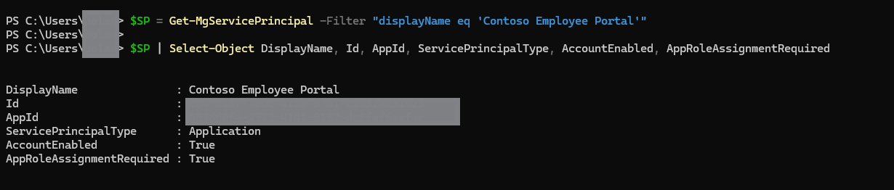


`AppRoleAssignmentRequired: True` independently validates the Enterprise Application's assignment-required configuration.


---


## Group Membership & Application Assignment


Microsoft Graph confirmed that the Employee Portal access group contained the authorized users Alex Carter and Jordan Lee.


Cameron Brooks was not included.


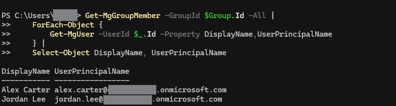


Graph also confirmed that:


```text

SG-APP-EmployeePortal-Users

```


was assigned to:


```text

Contoso Employee Portal

```


with the principal type:


```text

Group

```


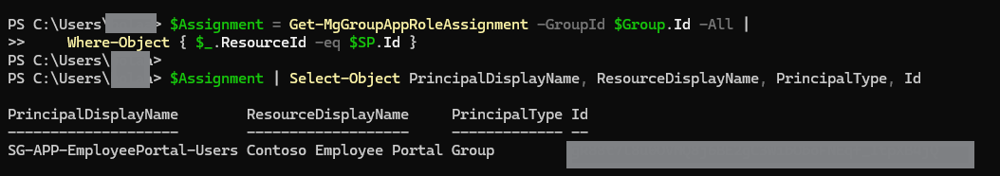


---


## OIDC Scope Validation


The application's configured identity scopes were resolved through Microsoft Graph as:


```text

openid

profile

```


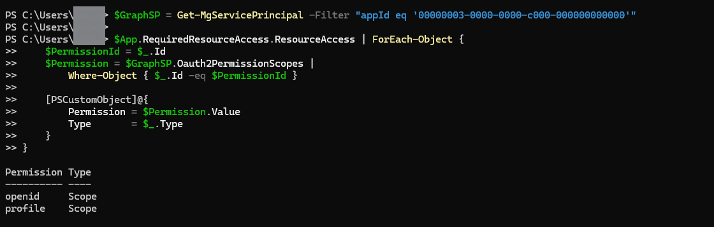


---


# SAML vs. OpenID Connect


| Area | SAML 2.0 | OpenID Connect |

|---|---|---|

| Project Application | Salesforce | Contoso Employee Portal |

| Primary Use | Enterprise federation / SSO | Modern application authentication |

| Entra Representation | Enterprise Application | App Registration + Enterprise Application |

| Identity Artifact | SAML Assertion | ID Token |

| Format | XML | JWT |

| Application Role | Service Provider | Relying Party / OIDC Client |

| Entra Role | Identity Provider | OpenID Provider |

| Return Endpoint | Reply URL / ACS | Redirect URI |

| Identity Mapping | NameID / Federation ID | Token claims |

| Flow Demonstrated | Browser-based SAML SSO | Authorization Code |

| Access Control | Entra application assignment | Entra application assignment |

| Negative Access Test | AADSTS50105 | AADSTS50105 |


Although both integrations provide centralized authentication through Microsoft Entra ID, the underlying protocols, application configuration models, and identity artifacts differ significantly.


---


# Security Considerations


Security practices incorporated into the project include:


- Dedicated security groups for application access

- Assignment-required enforcement

- Explicit unauthorized-user testing

- Authorization Code flow for the server-side OIDC application

- Client Secret stored in a local `.env` file rather than hardcoded into source code

- `.env` excluded from source control

- Python virtual environment excluded from source control

- Safe `.env.example` provided without credentials

- Sensitive identifiers redacted from public screenshots where appropriate

- Microsoft Graph used for independent configuration validation


The lab uses a client secret for the server-side OIDC application. Production environments should apply appropriate credential lifecycle controls and evaluate stronger workload authentication mechanisms where applicable.


---


# Project Results


The completed project demonstrates hands-on experience with:


- Microsoft Entra ID enterprise SSO

- SAML 2.0 federation

- OpenID Connect

- OAuth 2.0 Authorization Code flow

- SAML assertion-based identity mapping

- OIDC identity claims

- App Registrations

- Enterprise Applications

- Service principals

- Group-based application authorization

- Assignment-required enforcement

- Positive and negative access testing

- Entra sign-in log investigation

- SAML troubleshooting

- OIDC troubleshooting

- Microsoft Graph PowerShell validation

- Secure application credential handling


The project demonstrates how Microsoft Entra ID can provide a centralized identity layer across applications using different authentication protocols while maintaining application-specific authorization controls.


---


# Repository Structure


```text

Entra-ID-Enterprise-SSO-SAML-OIDC

│

├── Diagrams

│   └── 01-Entra-Enterprise-SSO-Architecture.png

│

├── Screenshots

│   ├── 01-Architecture

│   ├── 02-SAML-Salesforce

│   ├── 03-SAML-Troubleshooting

│   ├── 04-OIDC

│   ├── 05-OIDC-Troubleshooting

│   └── 06-Validation

│

├── Scripts

│   └── OIDC-App

│       ├── templates

│       │   ├── error.html

│       │   └── index.html

│       ├── .env.example

│       ├── .gitignore

│       ├── app.py

│       └── requirements.txt

│

├── .gitignore

└── README.md

```


---


## Key IAM Concepts Demonstrated


**Authentication**


SAML 2.0 • OpenID Connect • Single Sign-On • Authorization Code Flow • Federation • Identity Claims


**Authorization**


Security Groups • Enterprise Application Assignment • Assignment Required • Positive/Negative Access Testing


**Identity Architecture**


App Registrations • Enterprise Applications • Service Principals • Identity Provider • Service Provider • Relying Party


**Troubleshooting**


Entra Sign-in Logs • SAML Assertion Validation • NameID Mapping • AADSTS50105 • AADSTS50011 • MSAL Errors


**Administration & Validation**


Microsoft Graph • Graph PowerShell • Application Inspection • Service Principal Inspection • Group Membership Validation • Application Assignment Validation


